# Word shapes

This document is part of the forms stage in the [CLL](pipeline.md) pipeline. A stage is one step of a pipeline, with its own grammar ([engine §1](../../../docs/engine.md#1-tokens)).

A token is one unit that a stage reads or emits. A token's value is the string that exact comparisons read. Its image is the string that people see.

The document holds the sounds of the word forms in *The Complete Lojban Language* (CLL), edition 1.1. These are the consonants and their pairs, the vowels, diphthongs and stress. A diphthong combines two vowels in one syllable. The loader stitches it into the stage after [../common/forms.md](../common/forms.md) and before [morphology.md](morphology.md), which builds the words from these parts.

The BPFK, experimental, and Zantufa pipelines use the word forms in `grammars/lojban/bpfk/morphology.md` and do not use this document. BPFK is the Lojban language planning committee. [The notation document](../../../docs/notation.md) explains the notation.

The phoneme stage folds consonants to lowercase and writes each apostrophe with value `'`. It gives every vowel a lowercase value and marks stress with `Stressed`. It gives the syllable comma an empty value and the tag `Syllable-Break`.

Images spell phonemes in Latin letters. Only stressed vowels are capitals, and the syllable comma stays.

## Consonants

CLL[^cll-s3-6] forbids repeated consonants, two consonants from `c j s z`, and the pairs `cx`, `kx`, `xc`, `xk`, and `mz`. The voiced group contains b, d, g, j, v, and z. The unvoiced group contains c, f, k, p, s, t, and x. A pair cannot mix these two groups. The consonants l, m, n, and r are exempt from this voicing restriction. `$PERMISSIBLE` lists all 179 pairs that satisfy these restrictions.

Each consonant token has one lowercase Latin letter as its value, in both the Latin and Cyrillic scripts. Thus adjacent code points in a consonant run are exactly its adjacent token values.

CLL[^cll-s3-7] lists the 48 pairs in `$INITIAL` that can begin a word. A borrowing is a word taken from another language. A longer cluster can begin a borrowing if each adjacent pair in it is one of the 48 (CLL[^cll-s4-7]). So `spraile` is a borrowing, but not `ktraile` or `trkaile`. `long-initial-run` is every such cluster of three consonants or more.

CLL[^cll-s3-7] forbids the triples `ndj ndz ntc nts`, except in a name. The shared [consonant tables](../common/consonant-tables.md) hold `$INITIAL`, `$PERMISSIBLE` and `$AFFRICATES` for every Lojban pipeline.

```jbogenbau
%rule consonant
  | "b" | "c" | "d" | "f" | "g" | "j" | "k" | "l" | "m"
  | "n" | "p" | "r" | "s" | "t" | "v" | "x" | "z"

%rule initial-pair
  consonant consonant
%conditions
  $'value ∈ $INITIAL

%rule consonant-pair
  consonant consonant
%conditions
  $'value ∈ $PERMISSIBLE

%rule initial-cluster
  initial-pair | long-initial-run

%rule affricate
  consonant consonant
%conditions
  $'value ∈ $AFFRICATES

%rule n-affricate
  "n" affricate

%rule consonants
  {consonant}
```

<details><summary>Railroad diagrams of the 7 rules from <code>consonant</code> to <code>consonants</code></summary>
<p>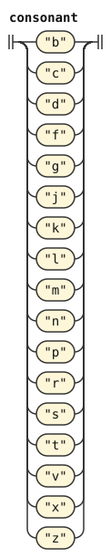</p>
<p>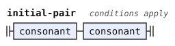</p>
<p>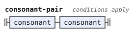</p>
<p>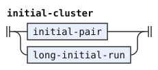</p>
<p>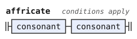</p>
<p>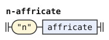</p>
<p>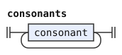</p>
</details>

A permissible run is a run of consonants whose adjacent pairs are all permissible. A name can have such a run anywhere (CLL[^cll-s3-7]). A borrowing can have one in its middle, with no `n` triple in it (CLL[^cll-s4-7]). The borrowing rules in [morphology.md](morphology.md#borrowings) exclude those triples with a [part query](../../../docs/notation.md#conditions) for `n-affricate`.

`permissible-run` reads a nonempty consonant run. Its value is the stage's default join of the consonant values. Every two adjacent letters of that value must form a pair in `$PERMISSIBLE`. A single consonant has no pair and satisfies the condition. So `.tlaiv.` and `.ekstcat.` are names, but `.djeimz.` and `.bobb.` are not.

```jbogenbau
%rule permissible-run
  consonants
%conditions
  $'value.ngrams(2).all(' ∈ $PERMISSIBLE)
```

<details><summary>Railroad diagram of <code>permissible-run</code></summary>
<p>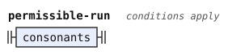</p>
</details>

`long-initial-run` reads at least three consonants. Every two adjacent values must form a pair in `$INITIAL`.

```jbogenbau
%rule long-initial-run
  consonant consonant consonant [consonants]
%conditions
  $'value.ngrams(2).all(' ∈ $INITIAL)
```

<details><summary>Railroad diagram of <code>long-initial-run</code></summary>
<p>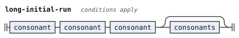</p>
</details>

## Vowels

A vowel of a word form has one of the lowercase values `a e i o u`, with or without `Stressed`. `y` is not one of them. It is a hyphen in a compound word (lujvo), a vowel of a name, a letter of a few particles (cmavo), and hesitation. A capital vowel marks stress, and nothing else about the word changes with the case of a letter.

The diphthongs of CLL[^cll-s3-4] are the falling `ai ei oi au` and the rising `ia ie ii io iu ua ue ui uo uu`. The rising ones can stand only in names and borrowings, and in a cmavo only as the whole word. A name can also have `iy` and `uy`. A diphthong can have a capital on either letter or on both, and it then marks one stressed syllable.

Cmavo stress is free.[^cll-s3-9] `stressed-vowel` reads a stressed vowel, and `stressed-name-vowel` also reads stressed `y`. A part query for `stressed-vowel` tests a stretch for a stressed vowel. One for `stressed-name-vowel` also finds a stressed `y`.

The rule `any-letter` includes commas through `Syllable-Break`.

```jbogenbau
%rule vowel
  "a" | "e" | "i" | "o" | "u"

%rule stressed-vowel
  vowel<Stressed>

%rule stressed-name-vowel
  name-vowel<Stressed>

%rule i-or-u
  "i" | "u"

%rule falling-diphthong
  "a" "i" | "e" "i" | "o" "i" | "a" "u"

%rule rising-diphthong
  i-or-u vowel

%rule y-diphthong
  i-or-u "y"

%rule any-letters
  {any-letter}

%rule any-letter
  consonant | vowel | "y" | "'" | Syllable-Break
```

<details><summary>Railroad diagrams of the 9 rules from <code>vowel</code> to <code>any-letter</code></summary>
<p>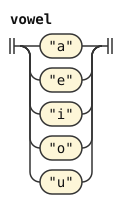</p>
<p>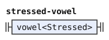</p>
<p>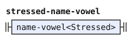</p>
<p>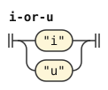</p>
<p>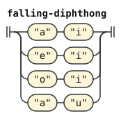</p>
<p>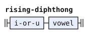</p>
<p>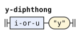</p>
<p>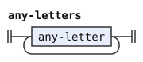</p>
<p>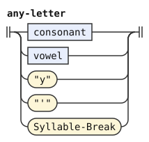</p>
</details>

## Syllables and stress

The syllable scans read commas by their `Syllable-Break` tag, because a comma token has an empty value. `brivla-item` permits only unstressed `y`. `name-item` permits stressed `y` too.

A run of vowels with no apostrophe or comma in it divides into syllables from the left (CLL[^cll-s3-5]). At each point, the next two vowels are one syllable if they form a diphthong that the word allows. Otherwise the next vowel is a syllable alone. So `briau` is `bria-u`, and `.meiin.` is `mei-in`. A name or a borrowing can have two vowels that form no diphthong, each its own syllable, as in the `korea` of `bangrkorea`. The [vowel choice](morphology.md#names-and-vowels) follows CLL's rule that commas are never required.

A syllabic consonant is a consonant pronounced as a syllable. The stress of a word depends on its syllables. CLL[^cll-s3-9] counts the syllables of `a e i o u` and their diphthongs. It does not count a syllable of `y`, `iy` or `uy`, or of a syllabic consonant. A syllabic consonant is still a consonant here, so it adds no syllable at all.

A brivla is a predicate word. It is stressed on its penultimate counted syllable. If a capital vowel marks the stress, every capital vowel of the brivla must be in that syllable, and exactly one counted syllable follows it. So `BAjykla` is right, because CLL[^cll-s3-9] does not count the `y`, and `bAIkla` is right, because `aI` is one syllable. A capital `Y` never stands in a brivla.

`brivla-scan` reads the letters of a brivla one syllable nucleus at a time, from the left. Its keys say where the stress is. A nucleus is a vowel or a diphthong of a brivla. The lookahead requires a vowel that stands alone as a nucleus to form no diphthong with the vowel after it. So the reading is unique, and it is CLL's grouping. The keys are:

- `S0`, `S1` and `S2` track the marked nucleus. `S0` holds before the scan reads a capital vowel, and `S1` after the one marked nucleus. `S2` holds after the marked nucleus and one more counted nucleus. A second marked nucleus removes all three tags. A second counted nucleus after the marked one does too.
- `nuclei`, the number of counted nuclei. It is 0, 1 or 2, or 3 for three or more. Each item adds one where it carries `Counted`.
- `First-Marked`, when the first counted nucleus is the marked one
- `Single-End`, when the last letter read is a vowel that is a nucleus by itself

A brivla with marked stress must have `S2`, and one without any capital vowel must have `S0`. [morphology.md](morphology.md) applies these stress tests. The word forms already require at least two counted nuclei.

```jbogenbau
%rule brivla-scan
  | $i:brivla-item
      → {nuclei: ($i'Counted ? 1 | 0),
         $i'Marked? S1,
         $i'Marked? First-Marked,
         ¬$i'Marked? S0,
         $i'Single-End}
  | $s:brivla-scan $j:brivla-item
      → {nuclei: ($s'nuclei + ($j'Counted ? 1 | 0)).at-most(3),
         ($s'S0 ∧ ¬$j'Marked)? S0,
         (($s'S0 ∧ $j'Marked) ∨ ($s'S1 ∧ ¬$j'Counted))? S1,
         (($s'S1 ∧ $j'Counted ∧ ¬$j'Marked) ∨ ($s'S2 ∧ ¬$j'Counted))? S2,
         ($s'First-Marked ∨ ($s'nuclei = 0 ∧ $j'Marked))? First-Marked,
         $j'Single-End}
%conditions
  ¬$s'Single-End ∨ ¬$s.last-token.onward.parse(brivla-diphthong …)

%rule brivla-item
  | consonant
  | "y"<¬Stressed>
  | "'" | Syllable-Break
  | $v:vowel → {Counted, Single-End, $v.parse(stressed-vowel)? Marked}
  | $d:brivla-diphthong → {Counted, $d.parse(… stressed-vowel …)? Marked}

%rule brivla-diphthong
  falling-diphthong | rising-diphthong
```

<details><summary>Railroad diagrams of <code>brivla-scan</code>, <code>brivla-item</code> and <code>brivla-diphthong</code></summary>
<p>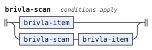</p>
<p>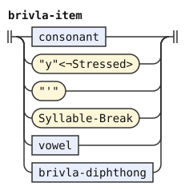</p>
<p>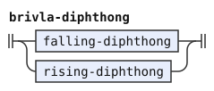</p>
</details>

A cmavo or a name can have capital vowels on any of its syllables, `Y` included (CLL[^cll-s3-9] lets their stress fall anywhere). A name with no capital vowel is stressed on its penultimate counted syllable if it has two or more. It is stressed on its only counted syllable if it has one, and nowhere if it has none.

`name-scan` reads a name as `brivla-scan` reads a brivla, with the diphthongs a name allows. A `y` is a nucleus of its own, and never the first letter of a diphthong. The choice `brivla-diphthong | y-diphthong` also admits `iy` and `uy`. The scan has these keys:

- `nuclei` and `Single-End`, as above
- `Seen-Nucleus` after the first nucleus, counted or not
- `First-Counted`, when the first nucleus is counted, and `First-Marked`, when it has a capital vowel
- `Any-Marked`, when some nucleus has a capital vowel

The forms stage uses the stress on the first syllable of a name, for the pause rule of CLL[^cll-s4-2] between two stressed syllables. This stress test applies when `la` or `doi` comes before a name with no pause.

```jbogenbau
%rule name-scan
  | $i:name-item
      → {nuclei: ($i'Counted ? 1 | 0),
         $i'Nucleus? Seen-Nucleus,
         $i'Counted? First-Counted,
         $i'Marked? First-Marked,
         $i'Marked? Any-Marked,
         $i'Single-End}
  | $s:name-scan $j:name-item
      → {nuclei: ($s'nuclei + ($j'Counted ? 1 | 0)).at-most(3),
         ($s'Seen-Nucleus ∨ $j'Nucleus)? Seen-Nucleus,
         ($s'First-Counted ∨ (¬$s'Seen-Nucleus ∧ $j'Counted))? First-Counted,
         ($s'First-Marked ∨ (¬$s'Seen-Nucleus ∧ $j'Marked))? First-Marked,
         ($s'Any-Marked ∨ $j'Marked)? Any-Marked,
         $j'Single-End}
%conditions
  ¬$s'Single-End ∨ ¬$s.last-token.onward.parse((brivla-diphthong | y-diphthong) …)

%rule name-item
  | consonant | "'" | Syllable-Break
  | $v:vowel → {Nucleus, Counted, Single-End, $v.parse(stressed-vowel)? Marked}
  | $y:"y" → {Nucleus, $y.parse(stressed-name-vowel)? Marked}
  | $d:brivla-diphthong → {Nucleus, Counted, $d.parse(… stressed-vowel …)? Marked}
  | $e:y-diphthong → {Nucleus, $e.parse(… stressed-name-vowel …)? Marked}

%rule name-vowel
  vowel | "y"
```

<details><summary>Railroad diagrams of <code>name-scan</code>, <code>name-item</code> and <code>name-vowel</code></summary>
<p>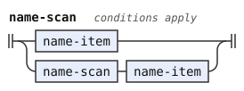</p>
<p>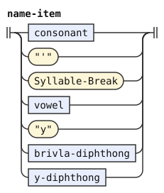</p>
<p>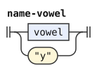</p>
</details>

## Differences from the format 49 grammar

The format 49 copy of this document is `grammars/lojban/cll/shapes.md`. Both copies read the same words with the same stress tests.

The scans count counted nuclei in the number `nuclei`, which stops at 3. The format 49 copy uses the four tags `N0` to `N3` for the same states. `Seen-Nucleus` takes the place of the two tags `V0` and `V1`. These keys stay inside the stage.

`consonants` and `any-letters` pass no tags from a single item. No rule reads a tag that reaches it only that way.

[^cll-s3-6]: [CLL 1.1, section 3.6](https://lojban.org/publications/cll/cll_v1.1_xhtml-section-chunks/section-clusters.html).

[^cll-s3-7]: [CLL 1.1, section 3.7](https://lojban.org/publications/cll/cll_v1.1_xhtml-section-chunks/section-initial-pairs.html).

[^cll-s4-7]: [CLL 1.1, section 4.7](https://lojban.org/publications/cll/cll_v1.1_xhtml-section-chunks/section-fuhivla.html).

[^cll-s3-4]: [CLL 1.1, section 3.4](https://lojban.org/publications/cll/cll_v1.1_xhtml-section-chunks/section-diphthongs.html).

[^cll-s3-9]: [CLL 1.1, section 3.9](https://lojban.org/publications/cll/cll_v1.1_xhtml-section-chunks/section-stress.html).

[^cll-s3-5]: [CLL 1.1, section 3.5](https://lojban.org/publications/cll/cll_v1.1_xhtml-section-chunks/section-vowel-pairs.html).

[^cll-s4-2]: [CLL 1.1, section 4.2](https://lojban.org/publications/cll/cll_v1.1_xhtml-section-chunks/section-cmavo.html).
