# Cyrillic orthography

This document adds gencmu's Cyrillic orthography to the phoneme stage, the first stage of the pipeline. It is the default Cyrillic of the [BPFK](../bpfk/pipeline.md) pipeline, and of the experimental and Zantufa pipelines in `grammars/lojban/`. BPFK is the Lojban language planning committee. The document has no frame of its own. It uses the shared text, pause and run rules. It adds its letters to the rules of [../cll/latin.md](../cll/latin.md) and [latin.md](latin.md), so a text can mix scripts.

A pipeline that lists neither this document nor [../cll/cyrillic.md](../cll/cyrillic.md) reads a Cyrillic letter as foreign. [The notation document](../../../docs/notation.md) explains the notation.

The rules map Cyrillic letters to their Lojban phonemes. The consonant mappings are `ш` for `c`, `ж` for `j`, `х` for `x`, and the others in the obvious ways. `ъ`, the Bulgarian hard sign, is `y`. Each letter below stands for its capital too. The rules also accept letters from other Cyrillic alphabets with the same or nearly the same sounds:

- `э` and `є` for `e`
- `і` for `i`
- `ы` and `ә` for `y`
- `щ` for `c`
- `ґ` for `g`
- `ј` for the glide `i`, as `й`
- `ў` for the glide `u`
- `һ` as an explicit apostrophe
- The palochka `ӏ` as a period

```jbogenbau
%rule cyrillic-consonant → {Consonant}
  | ("б" | "Б") → {image: value: "b"}
  | ("ш" | "Ш" | "щ" | "Щ") → {image: value: "c"}
  | ("д" | "Д") → {image: value: "d"}
  | ("ф" | "Ф") → {image: value: "f"}
  | ("г" | "Г" | "ґ" | "Ґ") → {image: value: "g"}
  | ("ж" | "Ж") → {image: value: "j"}
  | ("к" | "К") → {image: value: "k"}
  | ("л" | "Л") → {image: value: "l"}
  | ("м" | "М") → {image: value: "m"}
  | ("н" | "Н") → {image: value: "n"}
  | ("п" | "П") → {image: value: "p"}
  | ("р" | "Р") → {image: value: "r"}
  | ("с" | "С") → {image: value: "s"}
  | ("т" | "Т") → {image: value: "t"}
  | ("в" | "В") → {image: value: "v"}
  | ("х" | "Х") → {image: value: "x"}
  | ("з" | "З") → {image: value: "z"}
%emit

%rule cyrillic-apostrophe
  ("һ" | "Һ") → {image: value: "'"}
%emit

%rule cyrillic-period
  "ӏ" | "Ӏ"
```

<details><summary>Railroad diagrams of the 3 rules from <code>cyrillic-consonant</code> to <code>cyrillic-period</code></summary>
<p>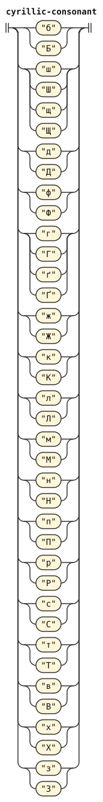</p>
<p>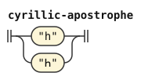</p>
<p>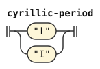</p>
</details>

Two adjacent full Cyrillic vowel letters form two syllables, so `аи` is `a'i` and `аъ` is `a'y`. The orthography writes a diphthong with the short forms `й` and `ў`, so `ай` is `ai` and `йъ` is `iy`.

So each full vowel letter, `ъ` and the other `y` letters included, carries the tag `Syllabic`. The vowel-group rules of [../cll/latin.md](../cll/latin.md) read that tag. The stage inserts an apostrophe between adjacent syllabic vowels. `й`, `ј` and `ў`, the glides, carry no such tag, and they join the vowel beside them into a diphthong.

Two `ъ` letters give `y'y`, so prolonged hesitation `yy` has no Cyrillic spelling.

A capital full vowel letter, or a combining accent after one, marks stress, as in Latin. A glide never marks stress, as the Latin `ĭ` of [latin.md](latin.md) does not. The full vowel carries the syllable's stress. So a capital glide is plain. In `lojban/bpfk` and `lojban/zantufa`, an accent after a glide makes its run foreign. The experimental override, [experimental/cyrillic.md](../experimental/cyrillic.md), ignores an accent on a glide.

Inside an all-capital run, the stage folds a capital vowel or glide, that is, it reads the letter as plain. An accented capital keeps its stress there.

The letters of `a`, `e`, `i`, `o` and `u` that are not glides carry `Syllabic` and `Vowel`. The `y` letters carry only `Syllabic`. The glides carry only `Vowel`. So each vowel rule below uses a helper such as `cyrillic-plain-full-vowel` for the letters with both tags.

The glides form rules of their own too. `cyrillic-plain-glide` holds the plain glides and carries `Vowel` on its header. `cyrillic-folded-glide` holds the folded glides in the same way. The `y` forms stay in the outer rule.

Each letter rule writes its two strings in its term, so a token has the phoneme as its value and its image. A capital that marks stress keeps the capital Latin letter as its image. `cyrillic-stressed-vowel` marks the full vowel as its primary, so the node keeps the vowel's strings and `Vowel` beside its own tags.

```jbogenbau
%rule cyrillic-plain-full-vowel → {Syllabic, Vowel}
  | "а" → {image: value: "a"}
  | ("е" | "э" | "є") → {image: value: "e"}
  | ("и" | "і") → {image: value: "i"}
  | "о" → {image: value: "o"}
  | "у" → {image: value: "u"}

%rule cyrillic-plain-glide → {Vowel}
  | (("и" | "И") glide-mark | "ј" | "Ј") → {image: value: "i"}
  | ("у" | "У") glide-mark → {image: value: "u"}

%rule cyrillic-plain-vowel
  | cyrillic-plain-full-vowel
  | ("ъ" | "ы" | "ә") → {Syllabic, image: value: "y"}
  | cyrillic-plain-glide
%emit

%rule cyrillic-stressed-full-vowel → {Vowel}
  | ("А" | ("а" | "А") stress-mark) → {value: "a", image: "A"}
  | (("Е" | "Э" | "Є") | ("е" | "э" | "є" | "Е" | "Э" | "Є") stress-mark)
      → {value: "e", image: "E"}
  | (("И" | "І") | ("и" | "і" | "И" | "І") stress-mark) → {value: "i", image: "I"}
  | ("О" | ("о" | "О") stress-mark) → {value: "o", image: "O"}
  | ("У" | ("у" | "У") stress-mark) → {value: "u", image: "U"}

%rule cyrillic-stressed-vowel → {Stressed, Syllabic}
  | ^cyrillic-stressed-full-vowel
  | (("Ъ" | "Ы" | "Ә") | ("ъ" | "ы" | "ә" | "Ъ" | "Ы" | "Ә") stress-mark)
      → {value: "y", image: "Y"}
%emit

%rule cyrillic-folded-full-vowel → {Syllabic, Vowel}
  | "А" → {image: value: "a"}
  | ("Е" | "Э" | "Є") → {image: value: "e"}
  | ("И" | "І") → {image: value: "i"}
  | "О" → {image: value: "o"}
  | "У" → {image: value: "u"}
  | "А" stress-mark → {Stressed, value: "a", image: "A"}
  | ("Е" | "Э" | "Є") stress-mark → {Stressed, value: "e", image: "E"}
  | ("И" | "І") stress-mark → {Stressed, value: "i", image: "I"}
  | "О" stress-mark → {Stressed, value: "o", image: "O"}
  | "У" stress-mark → {Stressed, value: "u", image: "U"}

%rule cyrillic-folded-glide → {Vowel}
  | ("И" glide-mark | "Ј") → {image: value: "i"}
  | "У" glide-mark → {image: value: "u"}

%rule cyrillic-folded-vowel
  | cyrillic-folded-full-vowel
  | ("Ъ" | "Ы" | "Ә") → {Syllabic, image: value: "y"}
  | cyrillic-folded-glide
  | ("Ъ" | "Ы" | "Ә") stress-mark → {Stressed, Syllabic, value: "y", image: "Y"}
%emit
```

<details><summary>Railroad diagrams of the 8 rules from <code>cyrillic-plain-full-vowel</code> to <code>cyrillic-folded-vowel</code></summary>
<p>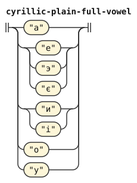</p>
<p>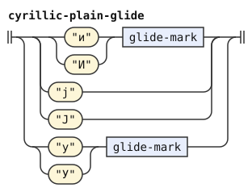</p>
<p>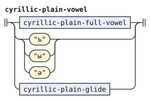</p>
<p>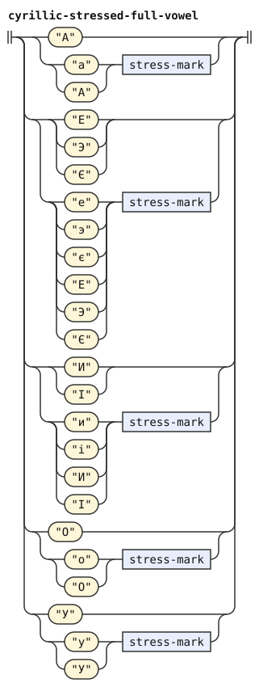</p>
<p>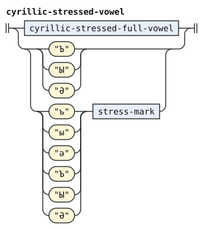</p>
<p>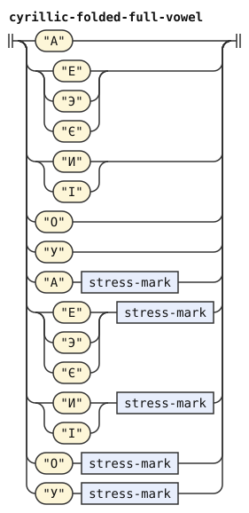</p>
<p>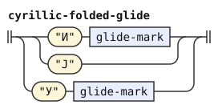</p>
<p>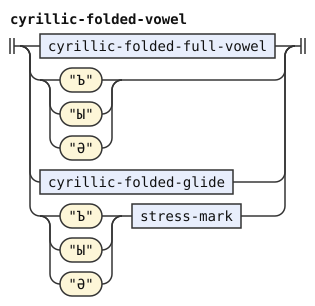</p>
</details>

The feature `cll-cyrillic` selects which Cyrillic rules apply. A feature is a named switch that the grammars test. The letters of this document apply while `cll-cyrillic` is off.

```jbogenbau
%extend-rule consonant
  ¬cll-cyrillic? cyrillic-consonant

%extend-rule apostrophe
  ¬cll-cyrillic? cyrillic-apostrophe

%extend-rule core-char
  ¬cll-cyrillic? cyrillic-period

%extend-rule plain-vowel
  ¬cll-cyrillic? cyrillic-plain-vowel

%extend-rule stressed-vowel
  ¬cll-cyrillic? cyrillic-stressed-vowel

%extend-rule folded-vowel
  ¬cll-cyrillic? cyrillic-folded-vowel
```

<details><summary>Railroad diagrams of the 6 rules from <code>consonant</code> to <code>folded-vowel</code></summary>
<p>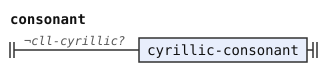</p>
<p>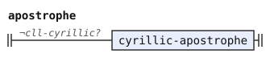</p>
<p>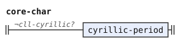</p>
<p>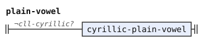</p>
<p>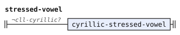</p>
<p>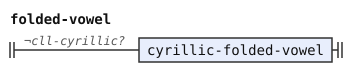</p>
</details>

## Differences from CLL

*The Complete Lojban Language* (CLL) supplies the base consonant mappings and uses `ъ` for `y`.[^cll-s3-12] It does not name the additional Cyrillic letters above. They let writers use letters from their familiar alphabets.

CLL writes diphthongs as vowel pairs, like Latin.[^cll-s3-12] This document instead gives full vowels separate syllables and uses short letters for glides. The same letters therefore need distinct readings in [../cll/cyrillic.md](../cll/cyrillic.md). The feature `cll-cyrillic` selects between them.

CLL requires only the vowel letter of a stressed syllable to be marked.[^cll-s3-1] This document assigns stress to the full vowel. It accepts capital full vowels and combining accents, but folds capitals inside an all-capital run. Capital glides remain plain. In `lojban/bpfk` and `lojban/zantufa`, accented glides make the run foreign. The experimental override, [experimental/cyrillic.md](../experimental/cyrillic.md), ignores their accents.

## Differences from the format 49 grammar

The format 49 copy of this document is `grammars/lojban/common/cyrillic.md`. Both copies hand on the same tokens, with the same strings and tags. The tags that these rules write, `Consonant`, `Vowel`, `Stressed` and `Syllabic`, are in the interface of [../cll/latin.md](../cll/latin.md).

[^cll-s3-12]: [CLL 1.1, section 3.12](https://lojban.org/publications/cll/cll_v1.1_xhtml-section-chunks/section-oddball-orthographies.html).

[^cll-s3-1]: [CLL 1.1, section 3.1](https://lojban.org/publications/cll/cll_v1.1_xhtml-section-chunks/chapter-phonology.html#section-orthography).
