# The word stream

This document defines the shared words stage of the Lojban pipelines. The `lojban/cll` pipeline includes it. Its rules also cover the classes and features of the `lojban/bpfk`, `lojban/experimental` and `lojban/zantufa` pipelines. A stage reads the tokens from the previous stage and emits tokens for the next stage.

A token is one unit that a stage reads or emits. A token's value is the string that exact comparisons read. Its image is the string that people see.

The [forms stage](forms.md) supplies source words. This stage applies quotes, compounds, erasers, hesitation, and FAhO. The [notation document](../../../docs/notation.md) explains the notation of the rules below.

A unit is one item on which an operation acts. An opaque unit hides its internal words from later operations. Every finished quote and compound emits one token.

A letteral is a letter word of class BY. The y letteral sounds like ybu.

The shared grammar processes operations from left to right. Zantufa adds two local exceptions in `grammars/lojban/zantufa/stream.md`. Later operations act on whole quote and compound units.

## The stream of elements

The stream contains live units and erased regions. A live unit is a unit that no eraser removes.

Each operator acts on the units that survive at its place in the stream. No operator reaches inside a unit.

A shared word reader supplies every requested word. It joins hesitation with a following `bu` before any operation takes that word. This exception applies inside ZO quotes, LOhU and LOhAI bodies, delimiters, and ZEI operands.

An erased region emits nothing. Later operators skip that region and use the surviving units beside it. Erasure never restores an earlier erased word.

A dangling `bu` creates a unit with a missing-base fault. A dangling `le'u` creates a unit with an unopened-quote fault. Constructors preserve these faults, and erasers remove the whole units.

A second `bu` wraps a fault unit like any other unit. Thus `bu bu si` leaves nothing. If a fault survives to the text end or an active `fa'o`, the words stage rejects the text.

An active `fa'o` ends the text. The stage reads no words after it. A quoted `fa'o` or a right operand of `zei` does not end the text.

BAhE marks the next word in the indicator stage. It remains a separate unit during word operations. The pipelines keep `mi ba'e fa'o` rejected because the surviving BAhE has no target.

The rule `empty` reads a prefix that leaves no units. Its alternatives use `text-start`, `si-word`, `erasure`, `su-word`, `su-cleared`, `sa-wiped`, and `sa-tail`. The `su-word` routes clear an empty prefix or the whole prefix. The `su-cleared` route clears a prefix without an SU boundary and keeps its boundary test beside the stream. The `sa-wiped` route reads unmatched SA. The `sa-tail` routes read trailing SA after an empty or nonempty prefix.

The stage defaults join the values and the images of the children of each rule. So a rule without its own strings spells what its parts spell, and an erased part adds nothing.

`$OUTPUTS` passes on every key of the forms stage. It also names each public tag that the rules of this stage write on the units they build. These tags are `Word`, `Cmavo`, `BY`, `BRIVLA` and `Y-Letter`. So the interface does not depend on the keys that the input happens to carry. The other keys of this stage stay inside it, `Fault`, `LEhU` on a fault and `letter` among them. A surviving fault makes `text` reject the stream, so no fault unit is handed on.

The rule `stream` gives each stretch of the stream the keys of all its surviving units. So `text` can reject a stream in which a fault survives.

```jbogenbau
%ambiguity-resolution lazy
%const $DEFAULTS $n ↦ {value: $n.children!'value.join(), image: $n.children!'image.join()}
%const $OUTPUTS {*$INPUTS, Word, Cmavo, BY, BRIVLA, Y-Letter}

%rule text
  | empty [faho-group]
  | $s:stream spacing [faho-group]
%conditions
  ¬$s'Fault

%rule text-start
  ε
%conditions
  $.starts-input

%rule empty
  | text-start spacing
  | empty si-word spacing
  | empty erasure spacing
  | sa-su? empty su-word spacing
  | sa-su? ¬su-boundary? stream spacing su-word spacing
  | su-cleared
  | sa-su? sa-wiped spacing
  | sa-su? empty sa-tail
  | sa-su? stream spacing sa-tail
%erased

%rule su-cleared
  sa-su? su-boundary? $s:stream spacing su-word spacing
%conditions
  ¬$s.classes.overlaps($SU-STOPS)

%rule stream
  | empty $u:unit → {*$u.flags}
  | $s:stream spacing $u:unit → {*$s.flags, *$u.flags}
  | $s:stream spacing erasure → {*$s.flags}

%rule unit
  word | quote | lerfu-word | zei-compound | fault-unit | su-survivor

%rule erasure
  si-erasure
  | sa-su? sa-erasure

%rule fault-unit → {Word, Fault}
  | empty cmavo-token<BU> → {BY}
  | lehu-marker → {LEhU}
%emit

%rule faho-group
  read-word<FAhO> [raw-tokens]
%erased

%rule sa-tail
  sa-su? sa-run spacing
%conditions
  ¬$.following-tokens.parse(read-word …)
```

<details><summary>Railroad diagrams of the 10 rules from <code>text</code> to <code>sa-tail</code></summary>
<p>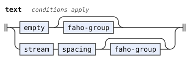</p>
<p>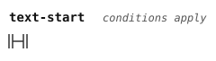</p>
<p>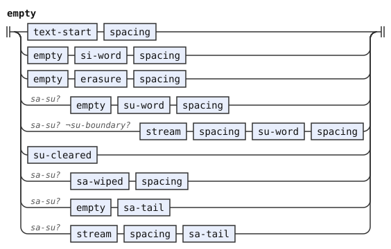</p>
<p>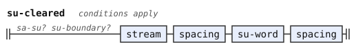</p>
<p>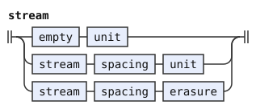</p>
<p>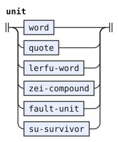</p>
<p>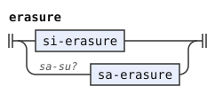</p>
<p>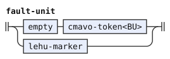</p>
<p>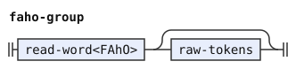</p>
<p>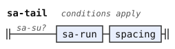</p>
</details>

### Spacing and hesitation

Hesitation emits nothing unless the word reader joins it with `bu`. The reader treats `yybu` as hesitation followed by the y letteral. The reader also forms the y letteral from `.yy. bu` and `.yyy. bu`.

`pause-run`, `quiet-gap` and `delimiter-quiet-gap` stay recursive because the lazy stage compares their step ends before closing a gap. The same applies to `raw-run-parts`, `raw-tokens` and `single-run-payload`, before the stage closes a quote.

`pause-run` groups consecutive pause tokens. `quote-gap-pauses` keeps its per-token test, so material pauses cannot enter that gap. Its end is fixed by the next token that is not a quiet pause, so no ranking step needs its steps. Its term gives the whole gap the value of one space. A raw quote body keeps punctuation and ignored characters.

`spacing` reads pauses and ordinary hesitation. `skipped` also reads erased regions. These rules keep surviving pauses, and none of them emits a token of its own.

`Quote-Material` also marks a gap with surviving punctuation or ignored material. Erased quote contents supply no such mark. `Punctuation-Material` distinguishes visible punctuation from ignored characters in these gaps.

Spacing and skipped regions reject surviving punctuation before the word `zei`, whatever class its lexicon assigns. Quoted contents execute no such operation.

`Gap-Pause` marks a gap with a surviving pause. `spacing` and `hesitations` introduce it. `skipped` and `erasures` carry it across erased children.

`$MATERIAL` names `Quote-Material` and `Punctuation-Material`. It is the material that can survive in a gap, as quoted material or as visible punctuation. `$GAP-MARKS` adds `Gap-Pause` to it. A gap rule copies only these keys from its parts.

A quiet pause carries only a spacing boundary. A material pause preserves punctuation or ignored text. The forms stage gives both kinds the value `" "`, and `$PAUSE` names that string. Their source text retains raw material. Gap rules give one space for surviving pauses.

An optional part, such as the hesitations of `spacing`, is a list of zero or one node. A gap rule joins the keys of each such list with `.union`.

```jbogenbau
%const $PAUSE " "

%const $MATERIAL {Quote-Material, Punctuation-Material}

%const $GAP-MARKS {Gap-Pause} ∪ $MATERIAL

%rule pause-run → {image: value: $PAUSE}
  | $p:PAUSE → {*$p.flags ∩ $MATERIAL}
  | $r:pause-run $q:PAUSE → {*$r.flags ∩ $MATERIAL, *$q.flags ∩ $MATERIAL}

%rule spacing
  [$p:pause-run] [$h:hesitations [$q:pause-run]]
      → {$p? Gap-Pause,
         $q? Gap-Pause,
         *$h!.flags.union ∩ $GAP-MARKS,
         *$p!.flags.union ∩ $MATERIAL,
         *$q!.flags.union ∩ $MATERIAL}
%conditions
  ¬$'Punctuation-Material ∨ ¬$.following-tokens.parse(zei-spelling …)

%rule skipped
  $s:spacing [$e:erasures $t:spacing]
      → {*$s.flags ∩ $GAP-MARKS, *$e!.flags.union ∩ $GAP-MARKS, *$t!.flags.union ∩ $GAP-MARKS}
%conditions
  ¬$'Punctuation-Material ∨ ¬$.following-tokens.parse(zei-spelling …)

%rule erasures
  | erasure → {}
  | $e:erasures $s:spacing erasure → {*$e.flags ∩ $GAP-MARKS, *$s.flags ∩ $GAP-MARKS}

%rule hesitation
  $h:y-run → {}
%conditions
  ¬$h.onward.parse(y-bu-word …)
%erased

%rule y-run
  Hesitation

%rule hesitations
  | hesitation → {}
  | $h:hesitations $p:pause-run hesitation
      → {Gap-Pause, *$h.flags ∩ $MATERIAL, *$p.flags ∩ $MATERIAL}
  | $h:hesitations hesitation → {*$h.flags ∩ $GAP-MARKS}
```

<details><summary>Railroad diagrams of the 7 rules from <code>pause-run</code> to <code>hesitations</code></summary>
<p>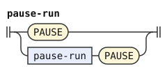</p>
<p>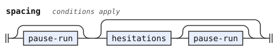</p>
<p>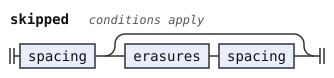</p>
<p></p>
<p>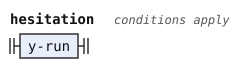</p>
<p>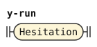</p>
<p>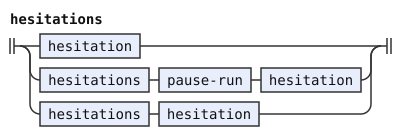</p>
</details>

## Words

The forms stage supplies source words, their lexical classes, and their run boundaries. A run is a stretch without a pause. This stage does not divide ordinary runs again.

The shared reader reads a cmavo, brivla, cmevla, or the y letteral. A cmavo is a particle. A brivla is a predicate word. A cmevla is a name word.

Every cmavo read in this shared reader uses `cmavo-token`. The replacement-quote closer of `grammars/lojban/common/lohai.md` reads `LEhAI` directly to preserve its specific expectation.

Only the `zei-spelling` test reads `Cmavo` directly, and it matches one spelling. CLL is *The Complete Lojban Language*. The CLL word family adds optional word-form warnings in `cmavo-token`. `brivla-token` and `cmevla-token` likewise let a pipeline warn on a predicate word or name. A warning travels on the unit that holds the word. An eraser that removes the word or its unit drops the warning.

A failed words stage publishes no warnings from that stage. A successful stage keeps warnings from its chosen derivation. Raw quote bodies and the suffix after active `fa'o` supply no word reads.

The lexicon gives each cmavo its classes. Operators use these classes rather than spelling, except the punctuation restriction on `zei`. The experimental word layer in `grammars/lojban/experimental/stream.md` extends that restriction to `ze'ei`. The experimental syntax can treat names as predicates without changing their lexical class.

The feature `sa-su` enables the two long-range erasers. If any input token has class SA or SU, the stage enables it. If the condition holds and the caller disables `sa-su`, the parse gives a `feature-conflict` result ([engine §13](../../../docs/engine.md#13-the-pipeline)).

```jbogenbau
%features sa-su
%conditions
  $.classes.overlaps({SA, SU})
```

Without SA or SU input, both feature states admit the same plain words. The rule `word` therefore excludes every magic-word class in either state.

`$MAGIC-WORDS` lists the operation classes that an ordinary word cannot carry.

The y letteral `y-bu-word` takes the private key `letter` of its y base, which `y-key` gives. It also copies `Run-Initial` from its first token and `Run-Final` from its last token.

```jbogenbau
%const $MAGIC-WORDS
  $WORD-QUOTE-MARKERS ∪ $ZOI-MARKERS ∪ $SINGLE-RUN-QUOTE-MARKERS ∪
  {LOhU, LEhU, FAhO, BU, ZEI, SI, SA, SU}

%rule read-word
  plain-word | y-bu-word

%rule plain-word
  cmavo-token | brivla-token | cmevla-token

%rule brivla-token
  BRIVLA

%rule cmevla-token
  CMEVLA

%rule y-bu-word
  $b:y-key [pause-run] $u:cmavo-token<BU>
      → {Word,
         BY,
         Y-Letter,
         $b'letter,
         $b.first-token.flags'Run-Initial,
         $u.last-token.flags'Run-Final}
%emit

-- Layers can add keys to the ordinary word through this hook.
%rule word-base
  read-word

%rule word
  $c:*word-base
%conditions
  ¬$c.classes.overlaps($MAGIC-WORDS),
  ¬$c.onward.parse(quote …)
%emit

%rule cmavo-token
  Cmavo
```

<details><summary>Railroad diagrams of the 8 rules from <code>read-word</code> to <code>cmavo-token</code></summary>
<p>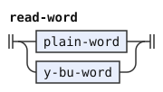</p>
<p>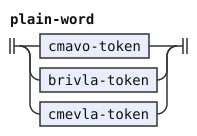</p>
<p>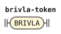</p>
<p>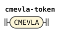</p>
<p>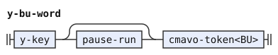</p>
<p>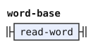</p>
<p>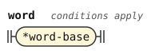</p>
<p>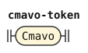</p>
</details>

## Quotes

Every complete quote is one opaque unit and emits one token. Later operations see its opening class and no class from its contents or closing marker. Indicators after it and BAhE before it mark the whole quote.

The token keeps the opening marker's class and the tags `Word` and `Cmavo`. Its image keeps the original spelling of the quoted material. An undelimited payload also keeps adjacent characters that no input token covers. The opening marker uses only its source text, so it takes no punctuation from the preceding word. Its value joins the values of its parts. A FOREIGN part gives its decomposed source text, and each gap gives the value of its rule below. The tree of the words stage retains the marker, contents, and closing delimiter.

Quoted Lojban keeps its written case instead of each word's normalized image. For example, `SINdarin` has image `sIndarin` alone, but `zo SINdarin` keeps its capitals.

The [Magic Words proposal](https://mw.lojban.org/papri/Magic_Words) says that `y` is not a word and counts as whitespace. Ordinary hesitation contributes no word or value. The quote image keeps its written form, including `.y.` in `zo .y. coi` and `lo'u .y. coi le'u`.

The completed LOhU unit exposes LOhU alone to SA. LEhU closes the quote but supplies no later search target inside it. Replacement quotes and pipeline quote kinds follow the same opacity rule.

```jbogenbau
%rule quote
  word-quote | zoi-y-quote | zoi-quote | lohu-quote | single-run-quote
```

<details><summary>Railroad diagram of <code>quote</code></summary>
<p>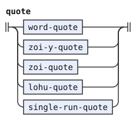</p>
</details>

### Shared word gaps

`word-gap` partitions a gap of ordinary hesitation and pauses. A quiet gap contributes no string. A gap with a surviving pause contributes `$PAUSE`, one space.

Quotes and the right operand of ZEI share this rule. It executes no erasure. Quotes use its empty route at their edges.

```jbogenbau
%rule quiet-gap
  | hesitation
  | quiet-gap hesitation

%rule pause-gap
  [quiet-gap] $p:pause-run [$h:hesitations [$q:pause-run]]
      → {*$p.flags ∩ $MATERIAL,
         *$h!.flags.union ∩ $MATERIAL,
         *$q!.flags.union ∩ $MATERIAL,
         image: value: $PAUSE}

%rule word-gap
  ε | quiet-gap | pause-gap
```

<details><summary>Railroad diagrams of <code>quiet-gap</code>, <code>pause-gap</code> and <code>word-gap</code></summary>
<p>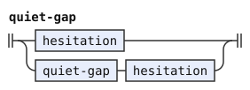</p>
<p>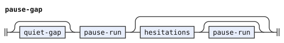</p>
<p>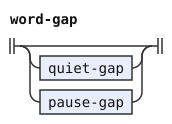</p>
</details>

### One-word quotes

ZO quotes one word from the shared reader or one standalone material stretch. Inside that quote, an eraser, compounder, or quote marker executes no operation. The reader still forms the y letteral.

`word-quote-gap` reads a clean `word-gap` and any punctuation attached to the target word. Standalone punctuation or ignored material cannot disappear into that gap. `word-quote-target` keeps attached closing punctuation in the quote image. A material target must fill its stretch between whitespace or periods. `zo-punctuation` also reads ignored material, including a comma or a format character. Its value is the decomposed source text of the mark, not the value of its pause token. The forms stage gives that token one space, which marks a word boundary, and a quoted mark must keep its own text.

An attached opening mark supplies one gap space, even without whitespace. `marker-attachment` also keeps a mark attached to the marker before whitespace. A period after that mark leaves it available as a standalone material target. `Period-Initial` identifies that boundary through the phoneme classification.

`quote-attachment` contributes no value at a closing edge. Its pause stays its primary, so its keys remain readable. `word-end-attachment` keeps a closing mark only before another pause or the text end. A mark before a following word stays in the gap, so BU keeps its separating space.

`$WORD-QUOTE-MARKERS` names the classes of the one-word quote marker. Such a marker quotes one word or one standalone material stretch. The `quote-marker` template shares the marker readers and takes their permitted classes as a key set.

```jbogenbau
%rule word-quote
  $m:word-quote-marker
      ($g:word-quote-gap $w:word-quote-target | $g:word-gap<¬Quote-Material> $w:zo-punctuation)
      → {*$m.flags, image: $m.source-text ++ $g.source-text ++ $w.verbatim-text}
%emit

%rule word-quote-gap
  | word-gap<¬Quote-Material>
  | word-gap<¬Quote-Material> quote-attachment → {image: value: $PAUSE}

%rule word-quote-target
  $w:read-word [word-end-attachment] → {*$w.flags, image: $.verbatim-text}
%conditions
  ¬$.following-tokens.parse(word-end-attachment …)

%rule marker-attachment
  quote-attachment
%conditions
  $.onward.parse(PAUSE<Quote-Material> PAUSE<¬Quote-Material ¬Period-Initial> …)

%rule word-end-attachment
  quote-attachment
%conditions
  $.ends-input ∨ $.following-tokens.parse(PAUSE …)

%rule quote-attachment
  ^PAUSE<Quote-Material> → {image: value: ""}

%rule zo-punctuation
  ^PAUSE<Quote-Material> → {value: $.decomposed-source-text, image: $.source-text}
%conditions
  $.ends-input ∨ $.following-tokens.parse(quiet-pause …)

%const $WORD-QUOTE-MARKERS {ZO}

%rule word-quote-marker = quote-marker(= $WORD-QUOTE-MARKERS)

%rule quote-marker(@Classes)
  $q:read-word [marker-attachment] → {Word, Cmavo, *$q.classes}
%conditions
  $q.classes.overlaps(@Classes),
  ¬$.following-tokens.parse(marker-attachment …)
```

<details><summary>Railroad diagrams of the 9 rules from <code>word-quote</code> to <code>quote-marker</code></summary>
<p>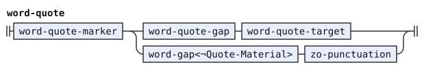</p>
<p>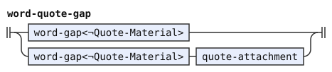</p>
<p>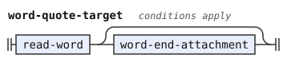</p>
<p>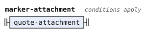</p>
<p>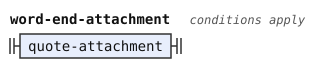</p>
<p>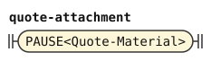</p>
<p>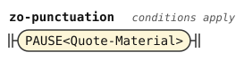</p>
<p>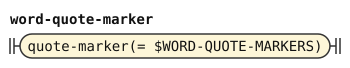</p>
<p>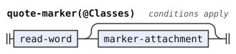</p>
</details>

### Single-run quotes

ZOhOI and MEhOI quote one raw stretch between whitespace or periods in the experimental pipeline. A decimal point between digits stays inside its run. `zo'oi` and `la'oi` use ZOhOI, and `me'oi` uses MEhOI. Punctuation, ignored characters and attached brackets belong to the stretch. The body must end before a quiet pause or the input end.

`$SINGLE-RUN-QUOTE-MARKERS` names the classes that quote a raw run. Layers extend this set while keeping the shared boundary tests.

`single-run-gap` starts with a quiet pause and skips hesitation through `single-run-hesitation`. It contributes one space, including pauses around erased hesitation.

The hesitation rule refuses a raw y letteral. In `zo'oi .y. bu`, the quote therefore takes the y run as its payload. BU then forms a letteral from the whole quote. The same rule keeps the prolonged run in `zo'oi .yyy. bu`.

```jbogenbau
%rule single-run-quote → {*$m.flags}
  | $m:single-run-marker $r:single-run-payload → {image: $m.source-text ++ $r'image}
  | $m:single-run-marker $g:single-run-gap $s:single-run-payload
      → {image: $m.source-text ++ $g.source-text ++ $s'image}
%conditions
  ¬$r.following-tokens.parse(payload-token …),
  ¬$s.following-tokens.parse(payload-token …),
  ¬$s.first-token.flags'Hesitation ∨ $s.first-token.onward.parse(raw-y-letter …)
%emit

%const $SINGLE-RUN-QUOTE-MARKERS {ZOhOI, MEhOI}

%rule single-run-marker = quote-marker(= $SINGLE-RUN-QUOTE-MARKERS)

-- A raw y letter joins its y base to bu across optional pauses.
%rule raw-y-letter
  raw-y-base [pause-run] cmavo-token<BU>

%rule single-run-hesitation
  $h:y-run
%conditions
  ¬$h.onward.parse(raw-y-letter …)
%erased

%rule single-run-hesitations
  single-run-hesitation
  | single-run-hesitations [quote-gap-pauses] single-run-hesitation

%rule single-run-gap
  quote-gap-pauses [single-run-hesitations [quote-gap-pauses]] → {image: value: $PAUSE}

%rule quote-gap-pauses
  {PAUSE<¬Quote-Material>} → {image: value: $PAUSE}
```

<details><summary>Railroad diagrams of the 7 rules from <code>single-run-quote</code> to <code>quote-gap-pauses</code></summary>
<p>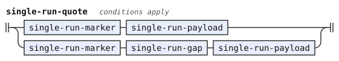</p>
<p>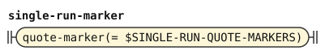</p>
<p>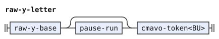</p>
<p></p>
<p>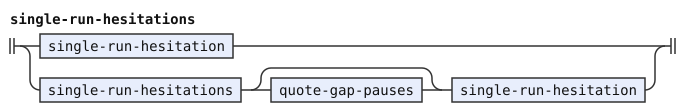</p>
<p>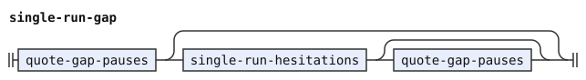</p>
<p>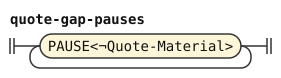</p>
</details>

### Delimited quotes

The ZOI words, `zoi` and `la'o`, skip hesitation and read the next real word as their opening delimiter. Hesitation never serves as a delimiter.

`delimiter-spacing` partitions quiet and paused gaps. The quiet route contributes no string. The paused route contributes one space for the whole gap. `delimiter-gap` also accepts a mark attached to the delimiter, with one gap space. It cannot skip a standalone material stretch.

Both spacing routes use `delimiter-hesitation`, which refuses the opening y letteral. This rule stays separate because Zantufa's ordinary hesitation also requires a spacing boundary.

The quotes close at the first matching whole run of nonpause tokens by exact value. Every pause, including punctuation, bounds such a delimiter run. ZOI compares foreign runs by their exact values too. Each test of `zoi-quote` reads the value of a node. A run's value joins the values of its tokens, and no rule below a run writes a string of its own.

The rule `zoi-y-quote` reads letteral delimiters formed from hesitation. The `lojban/zantufa` and `lojban/experimental` pipelines also form such a delimiter from `ie'o`. `grammars/lojban/zantufa/morphology.md` and `grammars/lojban/experimental/lexicon.md` describe it. Its opening delimiter is a `y-bu-word`, and its close is a `raw-y-close`. The rule `zoi-quote` reads every other delimiter, a cmavo, brivla or name, through `delimiter`. Its close is one `raw-run`. Each rule includes empty and nonempty bodies. A layer that adds a kind of word delimiter extends `delimiter`.

Ordinary compounds cannot become delimiters because the marker reads the delimiter before a later compounder acts. An empty body contributes empty strings to the quote token. Punctuation tokens form a nonempty body and retain their source text. A pause separates the body from the closing run. Attached marks around either delimiter add no value. A mark before another word stays in spacing.

`delimiter-body-gap` reads the boundary after the opening delimiter. A marked opening delimiter can place its closing mark across a period-only pause. A period-only pause carries `Period-Only` from the phoneme grammar. It contains no whitespace or ignored characters. The first whitespace ends that opening edge. Separate material stretches remain in the raw body.

The body leaves its final quiet pause to the closing gap. The closing edge keeps an attached mark before a pause or the text end. These boundaries give each mark and pause one owner.

`$ZOI-MARKERS` names the classes that open delimited quotes. Layers extend this set while keeping the shared delimiter rules.

```jbogenbau
%rule zoi-y-quote → {*$m.flags, image: $.source-text}
  | $m:zoi-marker $g:delimiter-gap $open:y-bu-word $b:delimiter-body-gap $content:zoi-body PAUSE
    [quote-attachment] $close:raw-y-close [word-end-attachment]
  | $m:zoi-marker $g:delimiter-gap $open:y-bu-word $b:delimiter-body-gap $content:empty-zoi-body
    [quote-attachment] $close:raw-y-close [word-end-attachment]
%conditions
  ¬$.following-tokens.parse(word-end-attachment …),
  ¬$b'Delimiter-Edge ∨ $g'Delimiter-Mark,
  ¬$g'Delimiter-Mark ∨ ¬$b'Period-Only ∨ ¬$b.following-tokens.parse(quote-attachment …),
  $open.has(letter) ∧ $close.has(letter) ∧ $open'letter = $close'letter,
  $open.has(letter) ∧
    ¬$content.parse(body-with-y-close).any($r ↦ $r.has(letter) ∧ $r'letter = $open'letter)
%emit

%rule zoi-quote → {*$m.flags, image: $.source-text}
  | $m:zoi-marker $g:delimiter-gap $open:delimiter $b:delimiter-body-gap $content:zoi-body
    PAUSE [quote-attachment] $close:raw-run [word-end-attachment]
  | $m:zoi-marker $g:delimiter-gap $open:delimiter $b:delimiter-body-gap
    $content:empty-zoi-body [quote-attachment] $close:raw-run [word-end-attachment]
%conditions
  ¬$.following-tokens.parse(word-end-attachment …),
  ¬$b'Delimiter-Edge ∨ $g'Delimiter-Mark,
  ¬$g'Delimiter-Mark ∨ ¬$b'Period-Only ∨ ¬$b.following-tokens.parse(quote-attachment …),
  $open'value = $close'value,
  ¬$content.parse(body-with-run).any($r ↦ $r'run = $open'value)
%emit

%const $ZOI-MARKERS {ZOI}

%rule zoi-marker = quote-marker(= $ZOI-MARKERS)

%rule delimiter
  plain-word<¬Y>

%rule delimiter-gap
  | delimiter-spacing
  | delimiter-spacing quote-attachment → {Delimiter-Mark, image: value: $PAUSE}

%rule delimiter-body-gap → {image: value: $PAUSE}
  | $p:PAUSE<¬Quote-Material> → {$p'Period-Only}
  | word-end-attachment PAUSE<¬Quote-Material>
  | ^interword-mark
  | period-pause (word-end-attachment PAUSE<¬Quote-Material> | interword-mark) → {Delimiter-Edge}

%rule period-pause
  PAUSE<¬Quote-Material Period-Only>

%rule interword-mark
  PAUSE<Quote-Material>
%conditions
  ¬$.ends-input,
  ¬$.following-tokens.parse(PAUSE …)

%rule delimiter-spacing
  | [delimiter-quiet-gap]
  | [delimiter-quiet-gap] pause-run<¬Quote-Material>
    [delimiter-hesitations [pause-run<¬Quote-Material>]]
      → {image: value: $PAUSE}

%rule delimiter-quiet-gap
  delimiter-hesitation | delimiter-quiet-gap delimiter-hesitation

%rule delimiter-hesitations
  delimiter-hesitation
  | delimiter-hesitations [pause-run<¬Quote-Material>] delimiter-hesitation

%rule delimiter-hesitation
  $h:y-run
%conditions
  ¬$h.onward.parse(y-bu-word …)
%erased

%rule empty-zoi-body
  ε

%rule zoi-body
  raw-tokens → {}
%conditions
  ¬$.last-token.flags'PAUSE ∨ $.last-token.flags'Quote-Material

%rule quiet-pause
  ^PAUSE<¬Quote-Material> → {image: value: ""}
```

<details><summary>Railroad diagrams of the 15 rules from <code>zoi-y-quote</code> to <code>quiet-pause</code></summary>
<p>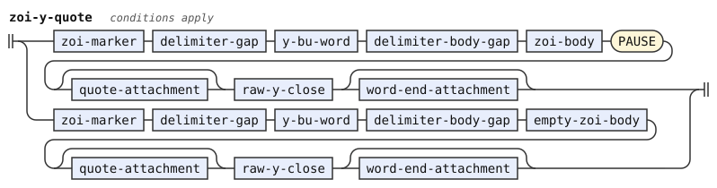</p>
<p>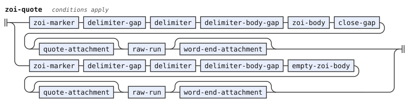</p>
<p>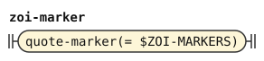</p>
<p>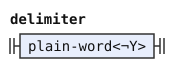</p>
<p>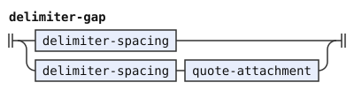</p>
<p>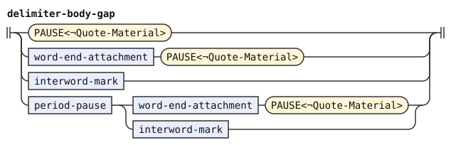</p>
<p>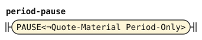</p>
<p></p>
<p></p>
<p></p>
<p></p>
<p></p>
<p></p>
<p></p>
<p></p>
</details>

### Closing delimiter runs

The y letteral can close on one `ybu` run or adjacent `y` and `bu` runs. The opening reader accepts both spellings. The closing test preserves adjacency and never joins the body into words.

Extra y sounds before the opening BU remain hesitation, even across a pause. The delimiter then sounds like ybu. A raw yybu or yyybu run cannot close it. Neither can a raw prolonged y run followed by BU.

Thus `zoi .yy. bu. foo .yy. bu.` fails, and `zoi .yy. bu. foo .y. bu.` succeeds. The opening reader drops extra y sounds, and the raw closing comparison keeps them.

The body remains raw and opaque. In `zoi bu. foo .y. bu.`, the final `bu` closes the quote. The preceding y remains body text.

A y base whose value is one of `$Y-LETTERS` gets the private key `letter`, which holds that value. The opening `y-key` and the closing `raw-y-key` both give it. The delimiter tests compare this key alone.

The forms stage separates the last opening y from preceding hesitation. `raw-y-key` applies the same tests but keeps every raw y value. A longer run gets no `letter`, so it cannot close the delimiter. A delimiter closes only where its opening and closing letters are equal.

The raw rule rejoins every piece of one y run. Its internal gap accepts pauses, including punctuation, as the opening y letteral does. Zantufa's `ie'o` exception in `grammars/lojban/zantufa/morphology.md` keeps each `ie'o` separate from adjacent hesitation.

`body-with-run` finds each whole run of a body. A run starts at the body's start or after a pause. `raw-run` ends it before a pause or at the body's end. A punctuation mark is a pause too, so it bounds a run. `zoi-quote` refuses a body with a run whose value equals the delimiter, so the quote closes at the first matching run. `body-with-y-close` does the same for a y letteral. Take `zoi gy foo"gy"bar gy` in a pipeline that keeps quote marks. The candidate body `foo"gy"bar` keeps the marks in its value, but its runs are `foo`, `gy` and `bar`. So the quote cannot take that body, and it closes at the first `gy`.

```jbogenbau
%const $Y-LETTERS ["y", "ie'o"]

%rule y-key
  $y:y-run → {$y'value ∈ $Y-LETTERS? letter: $y'value}

%rule raw-run
  $r:raw-run-parts
%conditions
  ¬$r.following-tokens.parse(close-run-token …)

%rule raw-run-parts
  close-run-token | raw-run-parts close-run-token

%rule close-run-token
  cmavo-token
  | run-token<¬Cmavo>

%rule raw-y-close
  $y:raw-y-key [pause-run] $b:close-run-token="bu" → {$y'letter}
%conditions
  $y.first-token.flags'Run-Initial,
  ¬$b.following-tokens.parse(close-run-token …)

%rule raw-y-base
  | y-run
  | $b:raw-y-base $h:y-run
%conditions
  $b'value ≠ "ie'o",
  $h'value ≠ "ie'o"

%rule raw-y-key
  $y:raw-y-base → {$y'value ∈ $Y-LETTERS? letter: $y'value}

%rule body-with-y-close → {$c'letter}
  | $c:raw-y-close [raw-tokens]
  | [raw-tokens] PAUSE $c:raw-y-close [raw-tokens]

%rule body-with-run → {run: $c'value}
  | $c:raw-run [raw-tokens]
  | [raw-tokens] PAUSE $c:raw-run [raw-tokens]
```

<details><summary>Railroad diagrams of the 9 rules from <code>y-key</code> to <code>body-with-run</code></summary>
<p></p>
<p></p>
<p></p>
<p></p>
<p></p>
<p></p>
<p></p>
<p></p>
<p></p>
</details>

### Ungrammatical quotes

A LOhU quote ends at the first LEhU. Its body reads Lojban words through the shared reader without executing operations. No magic word acts there, including BU, ZEI, and FAhO. A foreign run makes the quote fail.

`lohu-stream` uses `word-gap` between words. Its empty, quiet and paused routes are disjoint. The shared gap rules execute no eraser inside the quote.

The quote hands on one token, which covers its markers and its words. They hand on nothing of their own. A LEhU marker outside a quote is a fault unit, which the stream rejects.

```jbogenbau
%rule lohu-quote → {*$m.flags, image: $.source-text}
  | $m:lohu-marker word-gap lohu-stream word-gap lehu-marker
  | $m:lohu-marker word-gap lehu-marker
%emit

%rule lohu-marker
  $q:read-word<LOhU> → {Word, Cmavo, *$q.classes}

%rule lehu-marker
  $q:read-word<LEhU> → {Word, Cmavo, *$q.classes}

%rule lohu-stream
  | lohu-word
  | lohu-stream word-gap lohu-word

%rule lohu-word
  $w:read-word
%conditions
  ¬$w'LEhU
```

<details><summary>Railroad diagrams of the 5 rules from <code>lohu-quote</code> to <code>lohu-word</code></summary>
<p></p>
<p></p>
<p></p>
<p></p>
<p></p>
</details>

### Raw payloads

`raw-tokens` and `single-run-payload` keep word and FOREIGN values. Their material tokens take their value and image from source text. The forms stage gives a material pause the value of one space, because that value marks a boundary between words. A raw body keeps the mark itself, so `payload-token` reads its source text, as `zo-punctuation` does for a quoted mark. Delimited quotes take their images from their whole source intervals.

`run-token` reads each token that is no pause, such as a word, a hesitation or a FOREIGN run, with the value of its token. Its filter names only `PAUSE`, so it covers any nonpause kind that a layer adds, and no layer adds a nonpause kind to `payload-token`. A closing run reads only nonpause tokens, a cmavo through `cmavo-token`. So its value is the join of their values.

Only `single-run-payload` gives its body its own image. Its `.verbatim-text` preserves raw spelling and adjacent uncovered characters. The single-run quote reads that image through `'image`. A query and an erased body after FAhO never evaluate it.

```jbogenbau
%rule raw-tokens
  | any-token
  | raw-tokens any-token

%rule single-run-payload → {image: $.verbatim-text}
  | payload-token
  | single-run-payload payload-token

%rule any-token
  payload-token
  | PAUSE<¬Quote-Material>

%rule payload-token
  | run-token
  | ^PAUSE<Quote-Material> → {value: $.decomposed-source-text, image: $.source-text}

%rule run-token
  _<¬PAUSE>
```

<details><summary>Railroad diagrams of the 5 rules from <code>raw-tokens</code> to <code>run-token</code></summary>
<p></p>
<p></p>
<p></p>
<p></p>
<p></p>
</details>

## Compounds

The warnings of `cmavo-token` apply to every operator that it reads.

BU takes the preceding live unit and forms one letteral. ZEI takes that unit and the next word as read, then forms one BRIVLA unit.

The right word of ZEI executes no operation. Thus `.abu zei bu` has a literal BU operand. In `da zei de bu`, the final BU takes the completed compound.

The constructors can repeat and combine without exposing their operands. Each result keeps any fault of its base. SI erases the complete result as one unit.

Erased regions and ordinary hesitation can separate an operand from its operator. The compound's value and image omit these regions. Its text retains the original source span, including erased words. Erasure drops any warning from those regions.

`compound-gap` reads erased regions through `skipped`. Complementary `Gap-Pause` tests contribute one space or no string. `zei-right-gap` supplies the gap before ZEI's right word without executing erasure. ZEI rejects `Punctuation-Material` in both gaps. Ignored comma-like characters remain spacing. Each gap keeps the keys of its `skipped` part as its primary, so ZEI can test them.

`Trailing-Pause` marks a surviving SU boundary whose strings already end with a space. BU and ZEI then use `suppressed-gap` to avoid a second contribution. [Erasure by `sa` and `su`](#erasure-by-sa-and-su) explains that boundary and its strings.

```jbogenbau
%rule compound-gap
  | skipped<¬Gap-Pause>
  | ^skipped<Gap-Pause> → {image: value: $PAUSE}

%rule suppressed-gap
  ^skipped → {image: value: ""}

-- Layers can restrict the direct BU base through this hook.
%rule lerfu-base
  unit

%rule lerfu-word → {Word, BY, $u'Fault}
  | $u:*lerfu-base<¬Trailing-Pause> compound-gap cmavo-token<BU>
  | su-boundary? $u:*lerfu-base<Trailing-Pause> suppressed-gap cmavo-token<BU>
%emit

%rule zei-compound → {Word, BRIVLA, $l'Fault}
  | $l:unit<¬Trailing-Pause> compound-gap<¬Punctuation-Material> cmavo-token<ZEI> zei-right-gap
    read-word
  | su-boundary? $l:unit<Trailing-Pause> suppressed-gap<¬Punctuation-Material> cmavo-token<ZEI>
    zei-right-gap read-word
%emit

%rule zei-right-gap
  word-gap<¬Punctuation-Material>
```

<details><summary>Railroad diagrams of the 6 rules from <code>compound-gap</code> to <code>zei-right-gap</code></summary>
<p></p>
<p></p>
<p></p>
<p></p>
<p></p>
<p></p>
</details>

## Erasure by `si`

SI erases the preceding live unit. Quotes and compounds each count as one unit. A run of SI removes that many units and then does nothing on an empty stream.

SI skips hesitation and erased regions. It never erases an already executed SA or SU as a word. A fault unit is an ordinary operand for erasure.

The Zantufa lexicon in `grammars/lojban/zantufa/lexicon.md` gives `zei` class SI. The `si-word` reader therefore checks its spelling and refuses punctuation in the following gap. Other SI words keep their ordinary spacing.

```jbogenbau
%rule si-erasure
  unit skipped si-word
%erased

%rule si-word
  $q:cmavo-token
%conditions
  $q'SI,
  $q'value ≠ "zei" ∨ ¬$q.following-tokens.parse(punctuation-word-gap …)

%rule zei-spelling
  Cmavo="zei"

%rule punctuation-word-gap
  word-gap<Punctuation-Material>
```

<details><summary>Railroad diagrams of the 4 rules from <code>si-erasure</code> to <code>punctuation-word-gap</code></summary>
<p></p>
<p></p>
<p></p>
<p></p>
</details>

## Erasure by `sa` and `su`

SA reads its key from the next word before that word executes. It erases through the nearest preceding unit whose class matches that key. The next word stays and then executes normally.

The key of `sa .ebu` is the class of `.e`. BU has not yet formed that letteral. A letteral has class BY, so `sa bu` finds no BU inside it.

A cmavo missing from the lexicon has no class and matches no unit, even the same spelling. SA with such a key erases everything before it.

With no matching unit, SA erases everything before it. Thus `mi bu sa bu` removes the letteral and leaves a dangling BU fault. A later eraser can remove that fault.

Counted SA selects the second-nearest match for two markers, the third-nearest for three, and so on. The grammar nests one reach per marker. Too few matches erase the whole prefix.

SA at normal end has no key and erases back to the start of the text. SA before active FAhO uses FAhO as its key, erases the prefix, and then ends the text.

A reach is the stretch from a candidate unit to SA. Its keys are the classes of its first unit that no later live unit shares. Thus a surviving class identifies the nearest candidate for that key. Each nested SA intersects the possible target classes from its reaches. The rule `sa-wipe-core` handles too few matching units. No reach searches inside a quote or compound.

In `lojban/cll`, `lojban/bpfk`, and `lojban/experimental`, SU uses these four shared stopping classes: NIhO, LU, TUhE, and TO. Experimental adds LUhEI through its word layer in `grammars/lojban/experimental/stream.md`. The last surviving boundary word remains. Later LIhU, TOI, and TUhU do not cancel an earlier boundary. In Zantufa, SU erases everything before it.

The feature `su-boundary` makes SU keep its stopping boundary. A boundary inside an opaque unit cannot stop SU. With no boundary, SU erases the whole prefix. When a boundary survives SU, the grammar groups both into one unit. Thus `unit` includes `su-survivor`.

`su-survivor` takes its base as its primary, so it has the whole bag and both strings of its base. If its skipped tail has a surviving pause, it adds one space to both strings and sets `Trailing-Pause`. `unit` forwards that mark. If their left unit carries it, BU and ZEI suppress their next gap contribution and end the mark. The suppressed gap keeps its structure and erasure ownership.

The survivor emits the output of its base alone. Its trailing space acts only inside a covering compound. In `lojban/cll`, `lojban/bpfk`, and `lojban/experimental`, `ni'o su bu` has one space, and `ni'o subu` retains the earlier surviving space.

These examples show the target choice. `le broda le brode sa le` leaves `le broda le`. `le broda le brode sa sa le` leaves `le`. `mi bu sa bu` fails. `broda sa` leaves nothing.

The `su-word` hook reads SU, with a layer-specific restriction in Zantufa.

The rule `sa-key` refuses an SA key because a run of SA forms one counted erasure. A prefix query through `next-word-class` reads spacing and the next word only. Its keys supply the key classes.

```jbogenbau
%rule sa-erasure
  $s:sa-nest spacing $k:sa-key
%conditions
  $s.classes.overlaps($k.flags)
%erased

%rule sa-nest
  | $u:sa-reach spacing cmavo-token<SA> → {*$u.classes}
  | $u:sa-reach spacing $n:sa-nest spacing cmavo-token<SA> → {*$u.classes ∩ $n.classes}
%conditions
  $u.classes.overlaps($n.classes)

%rule sa-reach
  | $u:unit → {*$u.classes}
  | $s:sa-reach spacing $u:unit → {*$s.classes ∖ $u.classes}
  | $s:sa-reach spacing erasure → {*$s.classes}
%conditions
  $.classes ≠ {}

%rule sa-key
  ε → {*$.following-tokens.parse(next-word-class …).flags}
%conditions
  ¬$'SA

%rule next-word-class
  spacing $w:read-word → {Has-Word, *$w.classes}

%rule sa-run
  cmavo-token<SA>
  | sa-run spacing cmavo-token<SA>

%rule multiple-sa-run
  cmavo-token<SA> spacing sa-run

%rule sa-wiped
  | empty sa-run spacing $k:sa-key
  | $s:stream spacing sa-run spacing $k:sa-key
  | empty $n:sa-wipe-core spacing $k:sa-key
  | $s:stream spacing $n:sa-wipe-core spacing $k:sa-key
%conditions
  $k'Has-Word,
  ¬$s.classes.overlaps($k.flags),
  $n.classes.overlaps($k.flags)
%erased

%rule sa-wipe-core
  | $u:sa-reach spacing multiple-sa-run → {*$u.classes}
  | $u:sa-reach spacing $n:sa-wipe-core spacing cmavo-token<SA> → {*$u.classes ∩ $n.classes}
%conditions
  $u.classes.overlaps($n.classes)

%const $SU-STOPS {NIhO, LU, TUhE, TO}

%rule su-survivor
  | sa-su? su-boundary? ^$b:unit<Trailing-Pause> skipped su-suffix
  | sa-su? su-boundary? ^$b:unit<¬Trailing-Pause> skipped<Gap-Pause> su-suffix
      → {Trailing-Pause, value: $b'value ++ $PAUSE, image: $b'image ++ $PAUSE}
  | sa-su? su-boundary? ^$b:unit<¬Trailing-Pause> skipped<¬Gap-Pause> su-suffix
%conditions
  $b.classes.overlaps($SU-STOPS)
%emit
  $b

%rule su-suffix
  | su-word
  | su-reach spacing su-word
%erased

%rule su-reach
  | unit<¬$SU-STOPS>
  | su-reach spacing unit<¬$SU-STOPS>
  | su-reach spacing erasure

%rule su-word
  cmavo-token<SU>
```

<details><summary>Railroad diagrams of the 13 rules from <code>sa-erasure</code> to <code>su-word</code></summary>
<p></p>
<p></p>
<p></p>
<p></p>
<p></p>
<p></p>
<p></p>
<p></p>
<p></p>
<p></p>
<p></p>
<p></p>
<p></p>
</details>

## Choosing among parses

The stage uses lazy ambiguity resolution. It compares the first structural difference and favors closing a constituent over another token. The rules exclude readings that violate left-to-right operations.

The forms stage fixes ordinary word boundaries before this stage. For each word that an operation requests, the shared reader can form the y letteral. The stage adds no normalization step.

## Departures from CLL, Magic Words, and the reference parsers

### CLL and Magic Words

The pipelines follow the [Magic Words proposal](https://mw.lojban.org/papri/Magic_Words) with the departures below. The pipelines keep units opaque where that proposal exposes internal markers.

CLL describes erasure,[^cll-s19-13] hesitation,[^cll-s19-14] FAhO,[^cll-s19-15] and their interactions.[^cll-s19-16] These sections do not specify one complete processing order.

The pipelines use eight departures from CLL.[^cll-c19] Items 2, 4, and 8 differ in Zantufa. There ZEI erases, and hesitation attached to a word has class Y, as `grammars/lojban/zantufa/stream.md` defines.

1. SI, BU, and ZEI each take a whole quote or compound as one unit. The CLL examples[^cll-e19-77][^cll-e19-79] count quotation markers and contents separately. CLL[^cll-s19-16] defines BU and ZEI by the preceding word, and CLL[^cll-s17-4] limits BU to one word.
2. ZEI takes any next word as its right operand. CLL[^cll-s19-16] excludes several magic words from that interaction.
3. BU forms a letteral over BAhE. CLL[^cll-s17-4][^cll-s19-16] exclude BAhE as a BU base.
4. Ordinary hesitation counts as space, not a word. CLL[^cll-s19-14] gives y the class Y and requires pauses before and after `.y.`. These pipelines drop the following pause because they treat `y` as whitespace, as the Magic Words proposal does. That proposal states no pause rule. Only the shared reader forms the y letteral.
5. LOhU closes at the first LEhU. CLL[^cll-s19-16] excludes a LEhU after ZO, and CLL permits a ZOI quote inside LOhU.[^cll-s19-10]
6. ZOI compares whole raw runs by exact stored values, including FOREIGN values from decomposed source text. The CLL examples[^cll-e19-50][^cll-e19-51] instead forbid the delimiter's spelling or sound inside a longer run.
7. Every finished quote emits one token, with indicators after it and BAhE before it marking the whole quote. The Magic Words proposal names whole quotes as attitudinal targets. In camxes-std, the quote clauses take `pre_clause` before the quote and `post_clause` after it. This policy also applies to the newer quote kinds. CLL[^cll-s19-16] says that UI marks the previous word and BAhE the following word. In `zo coi ui` and `ba'e zo coi`, those words are `coi` and `zo`.

8. Except in Zantufa, SU erases back to the last surviving boundary word, and that word survives. The shared boundary classes are NIhO, LU, TUhE, and TO. Magic Words and camxes-std name these four boundaries. Experimental also stops at LUhEI through its word layer in `grammars/lojban/experimental/stream.md`. Later closing words do not cancel it. The boundary survives as in camxes-std, whose [`su_word`](https://github.com/lojban/ilmentufa/blob/778ea138f7d150121ca722db7536ce3b123943ac/camxes.peg#L402) excludes `NIhO_clause`, `LU_clause`, `TUhE_clause`, and `TO_clause`.

   CLL[^cll-s19-13] says that SU "erases the entire text". A stop at an open LU or TO agrees with CLL's `LU text` and `TO text`[^cll-c21]. CLL[^cll-s19-15] names these subordinate texts. A closed LU or TO is one that a later LIhU or TOI closed. A stop at a closed LU or TO follows Magic Words and camxes-std alone.

   So does every NIhO and TUhE stop. The stops at a closed LU or TO and the NIhO and TUhE stops depart from CLL[^cll-s19-13] under any reading.

In `lojban/cll`, `lojban/bpfk`, and `lojban/experimental`, `mi klama lu mi su do li'u` gives `(mi [klama {lu do li'u}])`. SU erases `mi` after `lu` and keeps the quote opener and the outer text.

In `lojban/cll`, `lojban/bpfk`, and `lojban/experimental`, `mi klama lu do cadzu li'u su broda` gives `(mi [klama {lu broda}])`. SU erases `li'u` and the other words after `lu`.

The [proposal's BU page](https://mw.lojban.org/papri/bu) lets SA BU reach inside a letteral. Its main page marks this interpretation controversial. These pipelines instead keep the letteral opaque. SA ZEI likewise finds no ZEI inside a compound.

The [Tiki copy of Magic Words](https://www.lojban.org/tiki/Magic+Words) strikes out "ZEI+BU grabs back to the last ZEI". Its ZEI paragraph instead lets SA before a brivla consume a whole ZEI clause. This grammar permits no search inside a compound.

The proposal also exposes a completed LOhU quote's LEhU ending to SA. These pipelines expose only the opening class. A constructor keeps the unopened-quote fault. `le'u bu` still fails, and `le'u bu si` is empty.

A dangling BU is also a fault unit that BU or ZEI can wrap. An eraser can remove the result, so `bu zei klama si` leaves nothing. The proposal's BU page instead forbids ZEI to bind a dangling BU on its left.

### Erasure in camxes and the pipelines

camxes-std, the standard grammar of the camxes parser, follows the grammatical reading of CLL[^cll-s19-13], without a class key. SA erases back to the start of a construct that the following words continue. Such a construct can be a term or sentence. camxes-std applies this rule unevenly. It accepts `broda sa broda` but rejects `lo broda sa broda`.

A run of letterals forms one camxes sumti, an argument of a predicate. Thus `by cy sa .ebu` erases both letters. In `by boi cy sa .ebu`, BOI ends the first sumti, so SA keeps `by`. `mi do sa ti` keeps `mi`, and `mi broda le brode sa ti` gives `mi broda ti`.

camxes-std reads `sa sa` as one SA. It rejects a trailing SA and an SA with no construct before it. Thus it rejects `mi do sa brodi`, `sa broda`, and `broda sa`. It also rejects `bu si` and `.abu sa bu`.

It rejects `mi ni'o do su si`, which `lojban/cll`, `lojban/bpfk`, and `lojban/experimental` reduce to `mi`.

These pipelines instead use the next word's class and select the nearest matching unit. Counted SA selects successively earlier matches. A trailing SA clears the text, as the `bu sa` row of the proposal's BU page specifies. The opaque-unit rule keeps `.abu sa bu` rejected in `lojban/cll`, `lojban/bpfk`, and `lojban/experimental`.

Zantufa gives SA class UI, so it performs no SA erasure.

[Departure 8](#cll-and-magic-words) states the shared SU stops and their relation to CLL. Zantufa erases the whole preceding text, as its reference grammar specifies.

### Final markers and Zantufa exceptions

The pipelines keep `mi ba'e fa'o` rejected. The stranded BAhE cannot mark a word after FAhO ends the text. Both camxes-std and camxes-exp, the standard and experimental camxes grammars, accept it. Their `FAhO_clause` absorbs BAhE through `pre_clause` ([standard](https://github.com/lojban/ilmentufa/blob/778ea138f7d150121ca722db7536ce3b123943ac/camxes.peg#L620), [experimental](https://github.com/lojban/ilmentufa/blob/778ea138f7d150121ca722db7536ce3b123943ac/camxes-exp.peg#L672)).

Zantufa retains its reference parser's quote-first fallback and SU-before-BU letter-base exception. Its pipeline document, `grammars/lojban/zantufa/pipeline.md`, defines both exceptions.

The raw one-word quotes retain punctuation and ignored characters instead of skipping them as spacing. This follows camxes-exp for `:)`, `#` and attached brackets.

Unlike camxes-exp's `non_space`, raw quotes here also keep `?` and `!` inside a raw stretch. Both are punctuation material under the shared Latin conventions.

camxes-exp keeps quotation marks inside a raw delimiter run. Thus `"gy"` cannot close an opening `gy` there. This stage instead closes at the first matching nonpause run, including beside punctuation. Every pause bounds that run, so a later delimiter cannot absorb following text.

Period tags keep these boundaries independent of script spelling. Zbalermorna and Cyrillic periods therefore follow the same quote rules as Latin periods.

Unlike camxes-exp, this stage accepts formatting marks attached to a quote marker or delimiter. Their source images keep the marks, which add no value. Whitespace ends an opening formatting edge, so standalone material cannot disappear. Raw body material retains its spelling.

Unlike camxes-exp, a decimal point between digits stays inside a raw run, as `grammars/lojban/common/latin.md` specifies. Thus `zo'oi 3.14 broda` quotes `3.14`, while camxes-exp quotes `3`. This keeps numeric spellings intact.

Unlike camxes-exp, a raw one-word quote takes a standalone comma instead of skipping it. Thus `zo'oi , broda` and `la'oi , klama` quote the comma here. camxes-exp quotes the following word. This follows the decision that ignored characters can form the quote body.

ZO can quote standalone punctuation or ignored material instead of moving to a later word. This extends the shared reader because material has no ordinary word class. Attached punctuation stays with the target word, as in `zo "la"`. This preserves the Latin convention for marks around words. A mark between the target and a following word remains spacing. BU therefore keeps its separating space after a quoted word.

The Zantufa lexicon in `grammars/lojban/zantufa/lexicon.md` gives `zei` class SI. The word `zei` rejects surviving punctuation on either side, even with that class. Other SI words retain their punctuation spacing. Ignored comma-like characters remain spacing for ZEI. This preserves the punctuation restriction across pipeline lexicons.

## Differences from the format 49 grammar

The format 49 copy of this document is `grammars/lojban/common/stream.md`. This document accepts the same texts and hands on the same tokens, with the same values and images. The public keys are the same, except on a y letteral.

The tokens carry the public keys that `$OUTPUTS` names: the keys of the forms stage and the five tags that this stage writes. The format 49 tokens of a y letteral also carry `Y-Key` for `y` or `Ieho` for `ie'o`. Here these two tags are gone, because no stage reads them. A y letteral keeps its letter in the private key `letter`.

The closing test of a y letteral delimiter compares `letter` on the two delimiters. The format 49 copy compares their key sets without the word marks. Both tests need a key on the opening delimiter. The forms stage always hands on a lone `y` before `bu`, so `y-key` always gives the key.

`zei-spelling` tests the value in its body, as `Cmavo="zei"`. The format 49 copy states the same test as a condition.

The delimiter tests of `zoi-quote` and `raw-y-close` read the values of nodes. The format 49 copy joins the values of their input tokens. The two are the same strings, because no rule below a delimiter or a run writes a string. The test for a delimiter inside the body finds each run of the body with `body-with-run`. The format 49 copy splits the joined input at each pause. Both divide the body at every pause, punctuation included.

On an unclosed raw quote, `expected` names `_<¬PAUSE>` of `run-token` in place of `Word`, `Hesitation` and `FOREIGN` of `payload-token`. Each `zoi` rule also names only its own closer, so `expected` omits the other closer's start.

[^cll-s19-16]: [CLL 1.1, section 19.16](https://lojban.org/publications/cll/cll_v1.1_xhtml-section-chunks/section-cmavo-interactions.html).

[^cll-s17-4]: [CLL 1.1, section 17.4](https://lojban.org/publications/cll/cll_v1.1_xhtml-section-chunks/section-bu.html).

[^cll-s19-14]: [CLL 1.1, section 19.14](https://lojban.org/publications/cll/cll_v1.1_xhtml-section-chunks/section-hesitation.html).

[^cll-s19-13]: [CLL 1.1, section 19.13](https://lojban.org/publications/cll/cll_v1.1_xhtml-section-chunks/section-erasure.html).

[^cll-e19-77]: [CLL 1.1, section 19.13, example 19.77](https://lojban.org/publications/cll/cll_v1.1_xhtml-section-chunks/section-erasure.html#c19e13d3).

[^cll-e19-79]: [CLL 1.1, section 19.13, example 19.79](https://lojban.org/publications/cll/cll_v1.1_xhtml-section-chunks/section-erasure.html#c19e13d5).

[^cll-e19-50]: [CLL 1.1, section 19.10, example 19.50](https://lojban.org/publications/cll/cll_v1.1_xhtml-section-chunks/section-more-quotations.html#c19e10d3).

[^cll-e19-51]: [CLL 1.1, section 19.10, example 19.51](https://lojban.org/publications/cll/cll_v1.1_xhtml-section-chunks/section-more-quotations.html#c19e10d4).

[^cll-s19-15]: [CLL 1.1, section 19.15](https://lojban.org/publications/cll/cll_v1.1_xhtml-section-chunks/section-faho.html).

[^cll-s19-10]: [CLL 1.1, section 19.10](https://lojban.org/publications/cll/cll_v1.1_xhtml-section-chunks/section-more-quotations.html).

[^cll-c21]: [CLL 1.1, chapter 21](https://lojban.org/publications/cll/cll_v1.1_xhtml-section-chunks/chapter-grammars.html).

[^cll-c19]: [CLL 1.1, chapter 19](https://lojban.org/publications/cll/cll_v1.1_xhtml-section-chunks/chapter-structure.html).
