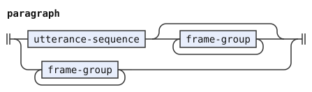
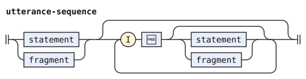
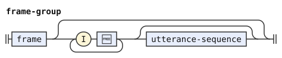
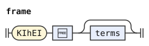

# Discourse frames (ki'ei)

This pipeline is a small example of extending the grammar of *The Complete Lojban Language* (CLL). It adds the particle `ki'ei` from [Ntsékees's proposal in Lensisku](https://lensisku.lojban.org/en/valsi/ki%27ei). An utterance is a statement or a fragment, as in CLL's `paragraph`. A frame is a context for subsequent utterances.

The proposal uses the material after `ki'ei` as the context or world for following utterances. Another `ki'ei` phrase resets that context.

The pipeline includes CLL and then extends two of its stages, forms and syntax. `%extend-stage` selects an earlier stage, and the lines after it join that stage. The CLL documents explain the inherited rules and parsing policy.

- [The CLL pipeline](../../cll/pipeline.md)
  ```jbogenbau
  %include "../../cll/pipeline.md"
  ```

A payload is the material after a marker. A sumti is an argument of a predicate. A term is a sentence argument or modifier. A termset groups arguments. Terms include sumti, termsets, tense or modal phrases, and `na ku`, as CLL's `term` rule reads them.

The frame accepts terms, so tenses and modals can set it as well as sumti. The payload after `ki'ei` accepts any number of CLL terms, including zero. For example, `ki'ei ko'a .i broda` supplies an argument, and `ki'ei pu zu ku .i broda` supplies a tense. The empty form `ki'ei .i broda` supplies no terms.

## The new word class

The inherited CLL stages already accept the word form of `ki'ei`, because it is a regular cmavo. A cmavo is a particle, a short structure word. The CLL lexicon gives each cmavo its selma'o, its word class. The lexicon is the constant `$LEXICON` of the forms stage, a classifier whose keys are the classes.

This layer redefines that constant. The splat `*$LEXICON` keeps every inherited class, and the new entry `KIhEI: "ki'ei"` adds one class with one word. A redefinition that reads its own name reads the version before it, so the layer adds to CLL and repeats nothing.

```jbogenbau
%extend-stage forms

%redefine-const $LEXICON {*$LEXICON, KIhEI: "ki'ei"}
```

No rule changes with it. The inherited rule [`source-word`](../../common/forms.md#words) tags a cmavo with each class that `$LEXICON.classify` finds, so `ki'ei` now carries `KIhEI`. A public tag is one that a stage hands on to the next stage. The forms stage publishes every key of the lexicon through `*$LEXICON.keys` in its `$OUTPUTS`.

Every other reader of `$LEXICON` reads its last version, wherever that reader stands, as [the notation](../../../../docs/notation.md#constants) says. So `source-word` and `$OUTPUTS`, which stand before this layer, both read the new class. The class is a key of the lexicon, not a tag that a rule of this layer writes. So `KIhEI` is a public tag of the stage, and the layer adds nothing to `$OUTPUTS`.

The words and indicators stages pass on every key of their input. So an ordinary `ki'ei` token keeps `KIhEI` through both. A word that the words stage builds is no ordinary token: `ki'ei bu` is one letteral token, with `BY` and no `KIhEI`. The syntax stage then reads the class as the terminal `KIhEI`. No further declaration marks `ki'ei` or restricts its class.

## Frames in a paragraph

The replacement paragraph rule accepts an initial sequence of utterances and subsequent groups with frames. It also accepts groups with frames at the start of a paragraph. Each group contains its frame and any subsequent `.i` sequence.

The layer redefines `paragraph`, because a frame changes what a paragraph is. The layer writes CLL's `paragraph` body again as the rule `utterance-sequence`, so CLL's paragraph stays one part of the new one. The notation cannot name the earlier version of a rule, so this copy follows CLL by hand. A change to CLL's `paragraph` must change it too. `&` accepts either part or both, in that order. The other rules of CLL read `paragraph` by name and need no change.

```jbogenbau
%extend-stage syntax

%redefine-rule paragraph
  utterance-sequence & {frame-group}

%rule utterance-sequence
  (statement | fragment) [{I 🆓 [statement | fragment]}]

%rule frame-group
  frame [{I 🆓} [utterance-sequence]]

%rule frame
  KIhEI 🆓 [terms]
```

<details><summary>Railroad diagrams of the 4 rules from <code>paragraph</code> to <code>frame</code></summary>
<p></p>
<p></p>
<p></p>
<p></p>
</details>

In `ki'ei ko'a .i broda .i brode ki'ei ko'e .i brodi`, the first group contains two utterances. The second group contains one. An earlier utterance can precede the first group, as in `broda ki'ei ko'a .i brode`.

The terms end at `.i`, another `ki'ei`, `ni'o`, or the enclosing text boundary. The grammar requires `.i` before an utterance after a frame. `.ije` does not serve, because it joins a statement to the one before it, and a frame is no statement. So `ki'ei ko'a .ije broda` is an error. Consecutive separators permit empty sentence positions before the first utterance, as in CLL paragraphs. Thus, `ki'ei ko'a .i .i broda` and `ki'ei ko'a .i .i` both parse. The grammar also accepts a frame without subsequent utterances, as in `ki'ei ko'a`. It also accepts consecutive frames, as in `ki'ei ko'a ki'ei ko'e .i broda`.

The CLL rules place `ni'o` outside each paragraph. This pipeline groups each frame with the `.i` sequence that follows it in the same paragraph. The grammar records these boundaries without deciding how an interpreter carries context across them.

This example accepts terms as payloads. It rejects a full predicate payload, such as `ki'ei ce'u purci ce'u .i broda`. It adds no pronoun for the selected world.

## Differences from the format 49 example

The format 49 copy of this example is `grammars/lojban/examples/kihei/pipeline.md`. The two blocks of this layer change nothing against that copy. The inherited CLL stages differ from their format 49 copies as the closing sections of the CLL documents say. A layer takes the differences of its base with it. So `ki'ei ui ko'a .i broda` gives one `ki'ei` token that covers its `ui`.

- The format 49 copy declares the class with `%classifier lexicon` and the entry `"ki'ei" ∈ KIhEI`. This copy redefines the constant `$LEXICON`, because the format 50 lexicon is a constant of the forms stage. The interface of the stage names every class of the lexicon, so the new class is public with no further declaration.
- The syntax rules are the same.
